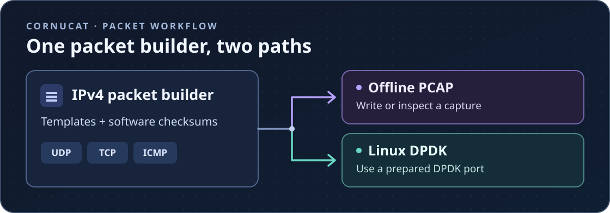

# CornuCat

**DPDK packet generator and PCAP inspector**

Build IPv4 UDP, TCP, and ICMP packets with a C11 core. Write and inspect
captures offline, or use CornuCat with a prepared Linux DPDK port.

**[Open the interactive packet demo ↗](https://dpdk-framework.github.io/cornucat/)**
· [Performance](#performance) · [Offline quickstart](#offline-quickstart) · [Linux builds](#optional-linux-builds)



Choose UDP, TCP, or ICMP in the demo to explore the packet layers. Switch
between static and sequence templates to see what changes and which checksum
needs to be updated. The demo runs entirely in your browser and sends no packets.

| Mode | What you can do |
| --- | --- |
| **Offline PCAP** | Generate frames without a NIC, inspect checksums, and count ICMP type/code pairs. |
| **Linux DPDK** | Use fixed or changing frame templates and control the packet count or rate. |
| **Optional F-Stack** | Run complete TCP sessions rather than constructing individual raw TCP frames. |

## Performance

### Single-core performance


| Sender | Single-core rate |
| --- | ---: |
| **CornuCat (DPDK)** | **13.6 Mpps** |
| Pktgen-DPDK | Approximately 8 Mpps |
| Default Linux stack — simple Python/C programs | Up to 1.5 Mpps |

## Offline quickstart

Requires a C11 compiler and GNU Make. These commands write and inspect a file
without sending network traffic.

```sh
make
make inspect-pcap
./build/packetgen --protocol udp --count 10 --output sample.pcap
./build/inspect-pcap --capture-only sample.pcap
```

CornuCat generates packets with software checksums by default. Static templates can
reuse checksums while their bytes stay the same; sequence templates update the
affected checksums when fields change. The offline inspector verifies supported
frames and reports ICMP type/code counts. Add `--require-udp-checksum` after
`--capture-only` to flag omitted IPv4 UDP checksums in a capture.

## Optional Linux builds

For the DPDK backend, install the DPDK development files and `pkg-config`
(`libdpdk` 23.07 or newer). On Linux with Python 3.10 or newer and a prepared
DPDK port, use `make dpdk` and `./packet-gen-dpdk` to open the setup menu.
`make receiver` builds the receive companion; `make relay` builds the optional
vhost-user relay. Raw TCP packet profiles are separate from complete TCP sessions.

The complete TCP mode needs [F-Stack v1.25 at the pinned revision](https://github.com/F-Stack/f-stack/tree/761639943bdda33103aa98241ca6a3079f1c1b7e)
in a fresh external checkout. With `FSTACK_DIR` pointing to that checkout and
the DPDK headers and libraries (23.11.4 was used for this integration) available:

```sh
git -C "$FSTACK_DIR" apply "$PWD/patches/fstack-1.25-multicore-hugepages.patch"
make -C "$FSTACK_DIR/lib" FF_KNI= FF_INET6=1 FF_TCPHPTS= FF_EXTRA_TCP_STACKS=
make tcp-session FSTACK_DIR="$FSTACK_DIR"
```

DPDK and optional F-Stack are external dependencies. See [LICENSE](LICENSE)
for the original MIT license and attribution.
